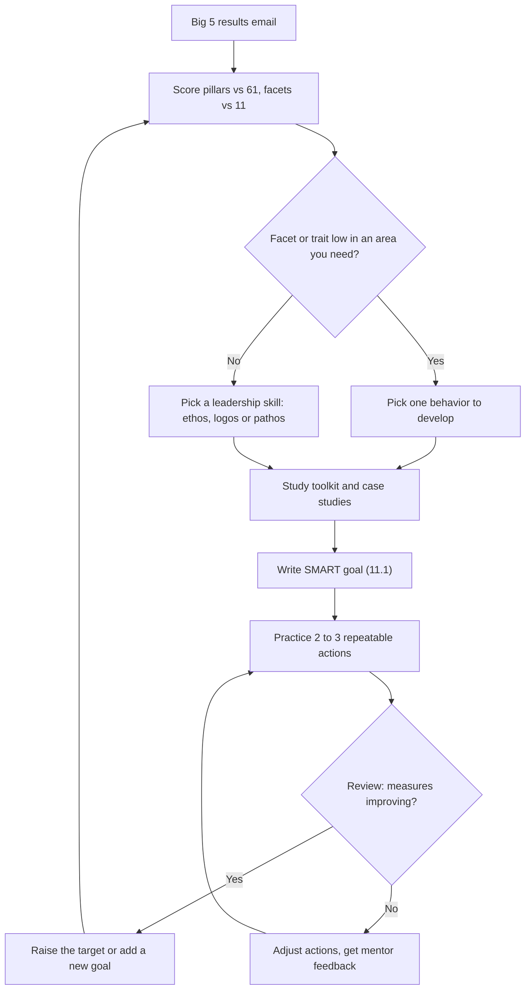

# Leadership Week 1: Professional Notes

Synthesis of: Big 5 guide and results, 3 leadership videos, 3 case studies, SMART goals (Assignments 11 and 11.1).

## 1. Executive Summary & Core Intent

**The Big Picture:** Leadership is a learned state, not an inborn trait. It starts with self-knowledge (Big 5 profile), is built through skills (credibility, logic, communication) inside a six-part toolkit, and is made real by a measurable plan (SMART goal). The case studies show these ideas working under pressure.

**Target Audience / Application:** Aspire Leaders participants, especially students planning a career (e.g. data analytics). Use it to finish the Week 1 reflections, choose one trait to develop, and write Assignment 11.1.

**Source map:**

- **Big 5 guide + results:** how to read scores, plus a personal profile
- **Videos:** "State not a Trait", "Leaders Born or Made", "Leadership Toolkit"
- **Case studies:** Nadella (pathos), Barra (credibility), Banga (logos)
- **SMART framework:** poster, Assignment 11 draft, 11.1 prompts

## 2. Key Pillars & Conceptual Breakdown

A. Big 5 personality: how to read it

- **Core Concepts:** Five pillars (OCEAN), each with 6 facets. Pillars are scored out of 120 and facets out of 20.
- **Critical Mechanisms:** Pillar is "high" above 61, facet "high" above 11. High or low is not better or worse; it shows how you use your strengths and what they may cost.
- **Granular Details:** Tap a pillar to see its facets (your scores shown). Green is high, red is low by the guide's cut-offs.

Your Self-Discipline (11) is not above 11, so it counts as low. Trust (10) is low even though Agreeableness is 93. Extraversion is high overall but Friendliness, Gregariousness and Activity are low.

B. Leaders are made, not born

- **Core Concepts:** Leadership is a state, not a trait. Twin studies show non-genetic factors matter more. Small "l" becomes big "L" through learning and intention.
- **Critical Mechanisms:** Skill building, practice, education, mentors and experiences. Take jobs that maximize learning; you start small and grow into leading.
- **Granular Details:** Aristotle's triangle: **Ethos** (credibility, earned and observable), **Logos** (logical, data-based reasoning), **Pathos** (persuasive communication). Genetic endowment (e.g. a booming voice) helps but does not define leadership. Advantages (family name) do not replace earned credibility.

C. The six-part Leadership Toolkit (Sitkin & Lind, Duke)

| Dimension | Meaning |
| --- | --- |
| Personal | Authentic style, values, philosophy of human behavior, vision, courage, passion. You can start now. |
| Relational | Interpersonal connection with others |
| Contextual | Right identity and context for success |
| Inspirational | Inspiring up, down and sideways |
| Supportive | Mobilizing and rallying others |
| Responsible | Stewardship, integrity, ethics; everything relies on it |

- **Developing personal leadership:** Notice leaders who turn you off (not your values) and leaders who motivate you (borrow their values). Keep a journal, then run mini experiments.
- Quote noted: leadership is a capacity to define oneself to others in a way that clarifies and expands a vision of the future.

D. Case studies: Pathos, Credibility, Logos

| Leader | Challenge | Response | Result |
| --- | --- | --- | --- |
| **Satya Nadella**, Microsoft (CEO 2014). Pathos | Stagnant, cutthroat culture; stack ranking; hoarded ideas; outdated reputation | "Learn-it-all" growth mindset; ended stack ranking; accessible design; rebuilt partner ties; listening | More collaboration and morale, more innovation (AI era), reputation and trust restored |
| **Mary Barra**, GM (CEO 2014). Ethos (credibility) | Faulty ignition switches linked to 100+ deaths; 10-year known issue; profit over safety | Transparent investigation; took responsibility; "Speak Up for Safety" line; held staff accountable; compensated victims | Regained trust and confidence; better communication across teams |
| **Ajaypal Banga**, Mastercard (CEO 2010). Logos | Post-2008 distrust; over a billion unbanked; cash reliance | Data-informed targeting (e.g. Egypt alimony payments, East Africa farm platform); measurable targets; digital partnerships | Goal of 500M unbanked reached by 2020; 1B target next; market cap above $300B in his 11 years |

Barra's screenshot is cut off at the top; the credibility framing is read from its visible text.

E. SMART goals

- **Core Concepts:** A goal that is Specific, Measurable, Attainable, Relevant, Timely.
- **Critical Mechanisms:** Ask the poster's question for each letter: what/who/where; how much and how will I know (baseline); do I have the skills and tools; does it support my long-term plans; by when and which milestones.
- **Granular Details (Assignment 11 draft):** job-ready for Data Scientist/Analyst in 12 months; 5 projects, 3 certifications, 200 problems, portfolio site; milestones by quarter (fundamentals, ML, certifications, applications).
- **Assignment 11.1 asks for:** one leadership behavior and why; 2 to 3 actions; frequency, timeframe, review; baseline and success measures; a one-sentence goal.

## 3. Workflow & Operational Cycle

**Phase 1: Know yourself.** Input: Big 5 email. Execution: compare pillars to 61, facets to 11. Output: strengths, costs, top two traits.

**Phase 2: Reframe.** Input: the two "made, not born" videos. Execution: accept leadership as learnable. Output: a growth stance.

**Phase 3: Map the toolkit.** Input: six dimensions. Execution: start with Personal leadership (values journal). Output: draft values and style.

**Phase 4: Study models.** Input: Nadella, Barra, Banga. Execution: label each as pathos, ethos or logos; note challenge, response, result. Output: patterns to borrow.

**Phase 5: Commit.** Input: chosen behavior. Execution: write the SMART goal (11.1). Output: one-sentence goal with measures.

**Phase 6: Practice and review.** Input: goal. Execution: repeat actions, collect feedback, review on a schedule. Output: adjusted goal and next cycle.

## 4. Flowchart

## 5. Pro-Tips, Tricks, and Hidden Traps

**Efficiency Tricks**

- Pair every trait with "how it helps" and "how it costs" (e.g. high Agreeableness: trust, but hard to critique).
- Build habits and routines instead of waiting for motivation (relevant to Self-Discipline).
- Reuse one reflection structure for videos: summary, reflection, one-line takeaway.
- Do personal-leadership work now; it needs no organization.

**Common Traps**

- Reading pillar scores out of 100: they are out of 120 (93 is about 78%). Check any notes that say "/100".
- Treating high as good and low as bad. The guide warns against this.
- Treating 61 and 11 as grades; scores near the line are balanced.
- Mixing up lookalikes: Intellect is not intelligence; psychological liberalism is not politics; low Morality is not immoral; low Extraversion is not shyness.
- Vague SMART goals: no baseline, no measure, no review date.
- Assuming credibility comes from status; the videos say it is earned and observable.

**Mental Models**

- **Dials, not switches:** traits move along a range.
- **Head, heart, character:** Logos (head), Pathos (heart), Ethos (character).
- **Inside out:** Personal leadership first, then relational, then the rest.
- **Banga/Barra/Nadella:** measure, own it, listen.

## 6. Actionable Next Steps & Deliverables

**Draft 11.1 sentence template:**\
"Over the next 90 days, I will improve my \[leadership behavior\] by \[2 to 3 specific actions\], and I will measure my progress through \[feedback, outcomes, or indicators\]."